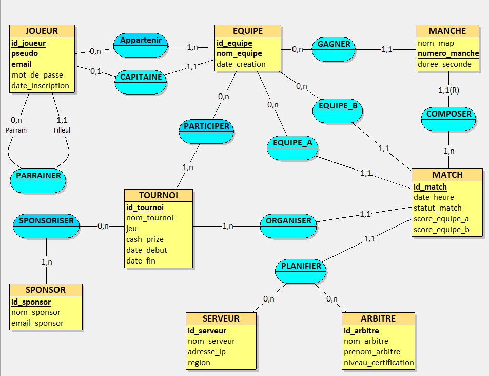
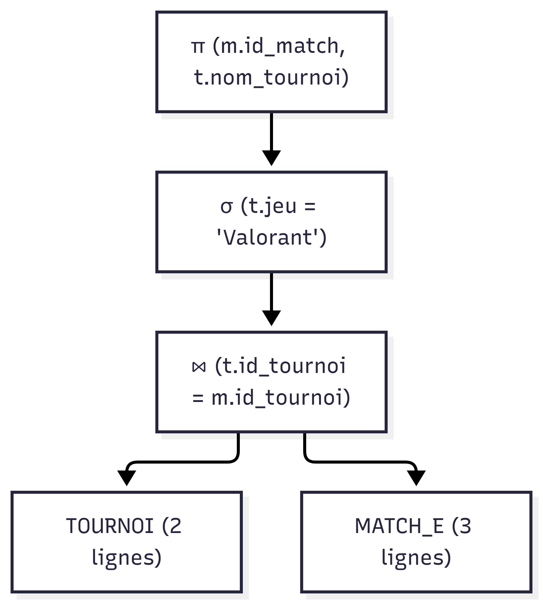
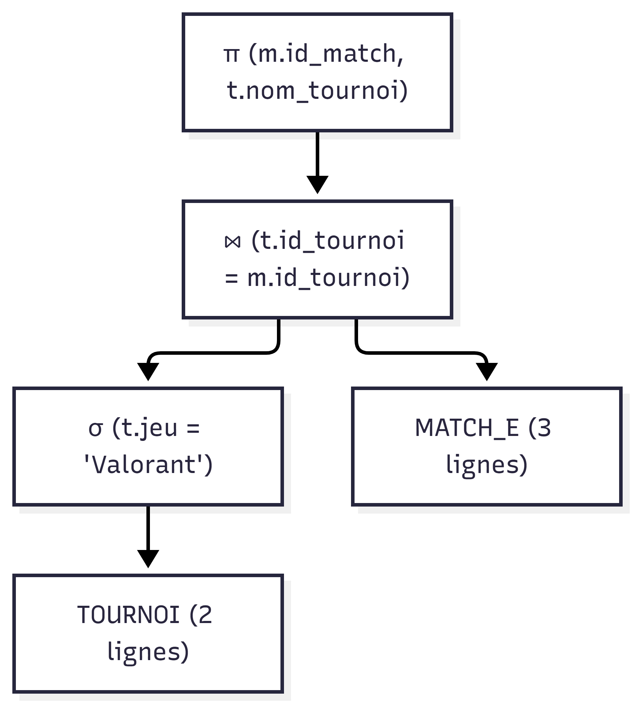

# Mini-Projet BDD : Plateforme e-sport

## Étape 1 : Analyse des besoins

### 1. Prompt RICARDO utilisé

* **[R - Rôle]** Agis en tant que Chief Data Officer et Architecte de Bases de Données expert, spécialisé dans le secteur de l'e-sport et des plateformes de compétition en ligne.
* **[I - Instructions]** 
  1. Analyse le contexte métier d'une plateforme d'organisation de tournois e-sport. 
  2. Formule une liste de règles métier (RM) claires, précises et numérotées. 
  3. Rédige un dictionnaire de données complet sous forme de tableau Markdown respectant la 3ème Forme Normale (3FN).
* **[C - Contexte]** Nous développons la base de données relationnelle d'une plateforme de gestion de tournois e-sport en ligne (jeux type Rocket League, Valorant). La plateforme doit gérer :
  - Les joueurs et leur parrainage.
  - Les équipes composées de joueurs et leurs capitaines.
  - Les tournois et leurs sponsors.
  - Les matchs d'un tournoi opposant deux équipes.
  - Les manches (maps/rounds) jouées au sein d'un match et l'équipe gagnante.
  - Les serveurs de jeu et les arbitres affectés aux matchs.
* **[A - Contraintes Additionnelles]** La modélisation et le dictionnaire de données doivent obligatoirement intégrer les trois éléments avancés suivants :
  1. Une association réflexive : un joueur peut parrainer d'autres joueurs (`PARRAINER`).
  2. Une entité faible / identification relative : la manche (`MANCHE`) dépend obligatoirement d'un match et est identifiée de manière relative par rapport à celui-ci (`1,1(R)`).
  3. Une association ternaire (ou n-aire n > 2) : la planification d'un match associe un Match, un Serveur de jeu et un Arbitre (`PLANIFIER`).
  Veille à ce que tous les attributs soient en 3FN (atomiques, sans dépendance partielle ni transitive).
* **[R - Références]** Inspiré des fonctionnalités et structures de données des plateformes e-sport de référence comme Start.gg, Faceit et Battlefy.
* **[D - Rendement Désiré]** Fournis une réponse structurée en deux parties : Partie 1 : "Règles Métier" (liste numérotée RM1, RM2, etc.). Partie 2 : "Dictionnaire de Données" (Tableau Markdown avec les colonnes : Entité / Association, Code attribut, Type de donnée, Contraintes / Propriétés).
* **[O - Objectifs]** Obtenir l'analyse des besoins nécessaire pour construire un Modèle Conceptuel de Données (MCD) valide et normalisé pour notre mini-projet de base de données.

---

### 2. Règles Métier (RM)

- **RM1 (Joueur & Parrainage)** : Un joueur est identifié par un identifiant unique (`id_joueur`). Un joueur peut parrainer d'autres joueurs (rôle Parrain) et ne peut être parrainé que par au plus un joueur (rôle Filleul) via l'association réflexive `PARRAINER`.
- **RM2 (Joueur & Équipe - Composition)** : Un joueur peut appartenir à zéro ou plusieurs équipes (`APPARTENIR`). Une équipe est composée d'au moins un joueur (`1,n`).
- **RM3 (Joueur & Équipe - Capitaine)** : Une équipe possède un seul et unique capitaine (`CAPITAINE`). Un joueur peut être le capitaine de zéro ou plusieurs équipes.
- **RM4 (Tournoi & Sponsor)** : Un tournoi peut être sponsorisé par zéro ou plusieurs sponsors (`SPONSORISER`). Un sponsor peut financer un ou plusieurs tournois (`1,n`).
- **RM5 (Inscription Tournoi)** : Un tournoi accueille une ou plusieurs équipes participantes (`PARTICIPER`). Une équipe peut s'inscrire à zéro ou plusieurs tournois (`0,n`).
- **RM6 (Match & Tournoi)** : Un match est organisé au sein d'un et un seul tournoi (`ORGANISER`). Un tournoi peut organiser un ou plusieurs matchs (`1,n`).
- **RM7 (Match & Équipes opposées)** : Un match oppose exactement deux équipes distinctes via les dépendances fonctionnelles `EQUIPE_A` et `EQUIPE_B`. Une équipe peut disputer zéro ou plusieurs matchs en tant qu'équipe A ou équipe B.
- **RM8 (Planification - Ternaire)** : La planification d'un match (`PLANIFIER`) associe exactement un Match (`1,1`), un Serveur de jeu (`0,n`) et un Arbitre (`0,n`). Un serveur et un arbitre peuvent superviser plusieurs matchs.
- **RM9 (Manche - Entité Faible & Victoire)** : Un match se compose d'une ou plusieurs manches (`COMPOSER`). La manche est une entité faible identifiée relativement à son match (`1,1(R)`). Chaque manche est remportée par une seule équipe (`GAGNER`), et une équipe peut gagner zéro ou plusieurs manches.

---

### 3. Dictionnaire de Données (3FN)

| Entité / Association | Code attribut | Type de donnée | Contraintes / Propriétés |
| :--- | :--- | :--- | :--- |
| **JOUEUR** | `id_joueur` | INT | PK |
| | `pseudo` | VARCHAR(50) | UNIQUE, NOT NULL |
| | `email` | VARCHAR(255) | UNIQUE, NOT NULL |
| | `mot_de_passe` | VARCHAR(255) | NOT NULL |
| | `date_inscription` | DATE | NOT NULL |
| **EQUIPE** | `id_equipe` | INT | PK |
| | `nom_equipe` | VARCHAR(100) | NOT NULL |
| | `date_creation` | DATE | NOT NULL |
| **TOURNOI** | `id_tournoi` | INT | PK |
| | `nom_tournoi` | VARCHAR(100) | NOT NULL |
| | `jeu` | VARCHAR(50) | NOT NULL |
| | `cash_prize` | DECIMAL(10,2) | NOT NULL, >= 0 |
| | `date_debut` | DATETIME | NOT NULL |
| | `date_fin` | DATETIME | NOT NULL |
| **SPONSOR** | `id_sponsor` | INT | PK |
| | `nom_sponsor` | VARCHAR(100) | NOT NULL |
| | `email_sponsor` | VARCHAR(255) | NOT NULL |
| **SERVEUR** | `id_serveur` | INT | PK |
| | `nom_serveur` | VARCHAR(100) | NOT NULL |
| | `adresse_ip` | VARCHAR(45) | NOT NULL |
| | `region` | VARCHAR(30) | NOT NULL |
| **ARBITRE** | `id_arbitre` | INT | PK |
| | `nom_arbitre` | VARCHAR(50) | NOT NULL |
| | `prenom_arbitre` | VARCHAR(50) | NOT NULL |
| | `niveau_certification` | VARCHAR(30) | NOT NULL |
| **MATCH** | `id_match` | INT | PK |
| | `date_heure` | DATETIME | NOT NULL |
| | `statut_match` | VARCHAR(20) | NOT NULL |
| | `score_equipe_a` | INT | DEFAULT 0 |
| | `score_equipe_b` | INT | DEFAULT 0 |
| **MANCHE** | `numero_manche` | INT | PK (Identification relative) |
| | `nom_map` | VARCHAR(50) | NOT NULL |
| | `duree_seconde` | INT | NOT NULL |

---

## Étape 2 : MCD



> Le fichier source Looping est disponible dans le dépôt sous le nom [`MCD.loo`](./MCD.loo)

## Étape 3 : MLD et MPD 

### III.A. MLD

- JOUEUR (<ins>id_joueur</ins>, pseudo, email, mot_de_passe, date_inscription, #id_joueur_parrain)
- EQUIPE (<ins>id_equipe</ins>, nom_equipe, date_creation, #id_joueur)
- TOURNOI (<ins>id_tournoi</ins>, nom_tournoi, jeu, cash_prize, date_debut, date_fin)
- SERVEUR (<ins>id_serveur</ins>, nom_serveur, adresse_ip, region)
- ARBITRE (<ins>id_arbitre</ins>, nom_arbitre, prenom_arbitre, niveau_certification)
- SPONSOR (<ins>id_sponsor</ins>, nom_sponsor, email_sponsor)
- MATCH (<ins>id_match</ins>, date_heure, statut_match, score_equipe_a, score_equipe_b, #id_tournoi, #id_equipe_a, #id_equipe_b, #id_serveur, #id_arbitre)
- MANCHE (<ins>id_match</ins>, <ins>numero_manche</ins>, nom_map, duree_seconde, #id_equipe_gagnante)
- APPARTENIR (<ins>#id_joueur</ins>, <ins>#id_equipe</ins>)
- PARTICIPER (<ins>#id_equipe</ins>, <ins>#id_tournoi</ins>)
- SPONSORISER (<ins>#id_sponsor</ins>, <ins>#id_tournoi</ins>)


## Étude des plans d'exécution

Pour illustrer l'optimisation des requêtes, nous avons analysé une requête de sélection et de jointure complexe : la recherche des noms de tournois et des éditeurs associés pour l'éditeur `'Riot Games'`.

### 1. Requête SQL analysée:

```
SELECT t.nom_tournoi, j.editeur 
FROM Tournoi t
JOIN Jeu j ON t.id_jeu = j.id_jeu 
WHERE j.editeur = 'Riot Games';
```

Cette requête combine trois opérateurs de l'algèbre relationnelle :
La sélection ($\sigma$) : filtre les lignes de la table Jeu où editeur = 'Riot Games'.
La jointure ($\bowtie$) : associe les tables Tournoi et Jeu sur id_jeu.
La projection ($\pi$) : extrait les colonnes nom_tournoi et editeur.

2. Comparaison des plans d'exécution

Plan A : Jointure globale avant sélection (Non optimisé)Dans ce plan, le système réalise d'abord la jointure complète entre toutes les lignes de Tournoi et de Jeu, puis filtre le résultat.
Arbre relationnel (Plan A) : 



Calcul du coût (Plan A) :Lecture des tables sources : $5 + 5 = 10$ lignes lues.Jointure ($\bowtie$) : croisement de 5 tournois et 5 jeux $\rightarrow 5 \times 5 = 25$ opérations intermédiaires pour générer 5 lignes jointes.
Sélection ($\sigma$) : évaluation de la condition sur les 5 lignes jointes $\rightarrow 5$ opérations (conserve 2 lignes).
Projection ($\pi$) : extraction sur les 2 lignes restantes $\rightarrow 2$ opérations.Coût total = $10 + 25 + 5 + 2 = 42$ opérations.

Plan B : Poussée de la sélection / Push-down Predicate (Optimisé)Dans ce plan, la sélection est poussée au plus bas de l'arbre sur la table Jeu avant de réaliser la jointure.
Arbre relationnel (Plan B) : 



Calcul du coût (Plan B) :Lecture des tables sources : $5 + 5 = 10$ lignes lues.Sélection ($\sigma$) en amont sur Jeu : filtrage sur 5 jeux $\rightarrow 5$ opérations (conserve 2 jeux).Jointure ($\bowtie$) sur données réduites : croisement de 5 tournois et 2 jeux filtrés $\rightarrow 5 \times 2 = 10$ opérations (génère 2 lignes).
Projection ($\pi$) : extraction sur les 2 lignes restantes $\rightarrow 2$ opérations.Coût total = $10 + 5 + 10 + 2 = 27$ opérations.

Conclusion sur l'optimisation
Le Plan B est le plan d'exécution optimisé retenu. 
En appliquant l'opérateur de sélection ($\sigma$) au plus près des données sources (Push-down Predicate), on réduit la table Jeu de 5 à 2 lignes avant la jointure. Cela diminue le nombre total d'instructions de 42 à 27, évitant au moteur de traiter des données inutiles lors de l'étape de jointure.  
